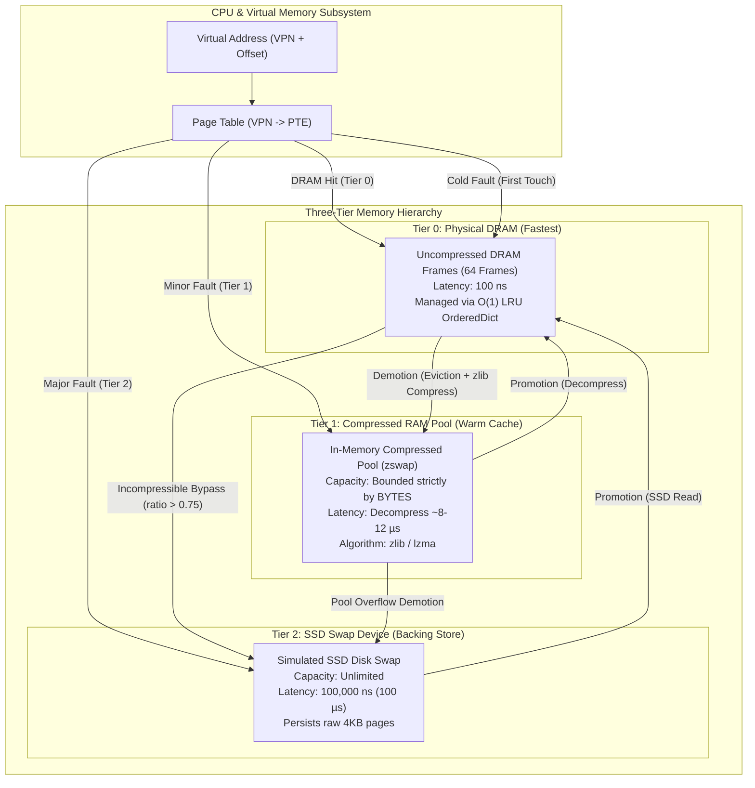
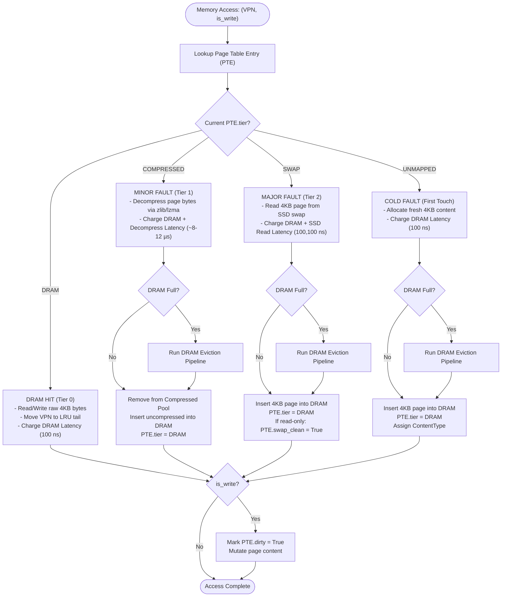
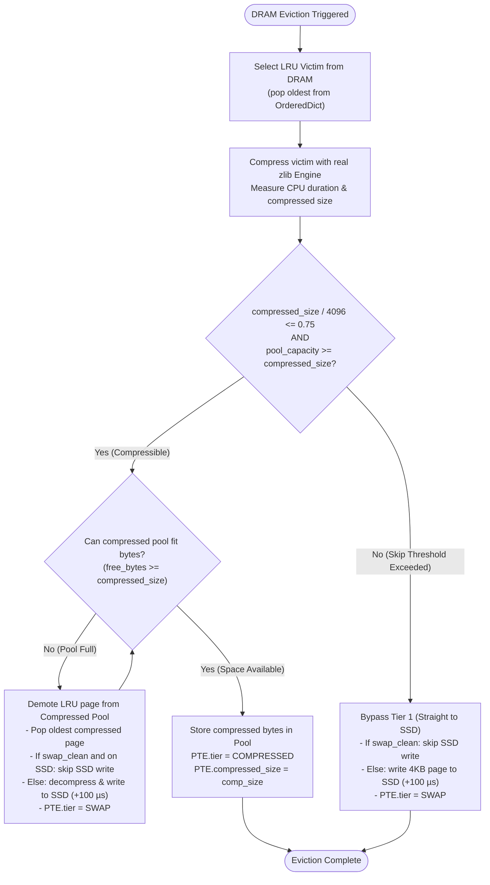
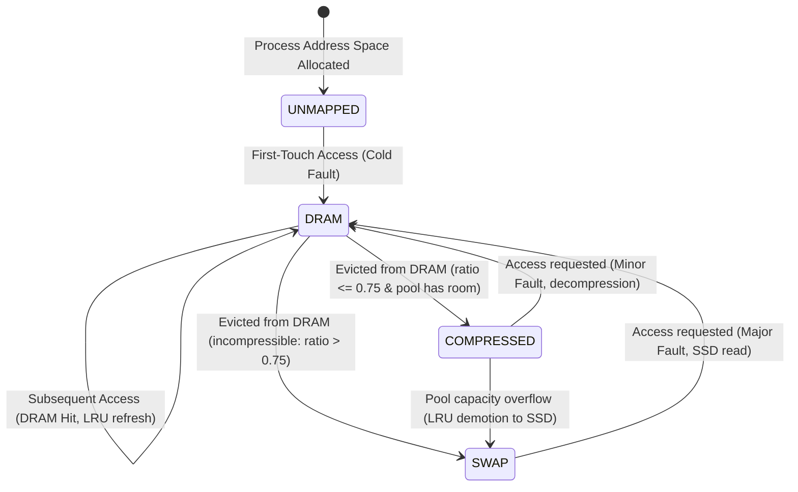

# System Architecture: Tiered Virtual Memory Manager

This document provides architectural diagrams and control-flow models for the Tiered Virtual Memory Manager with Page Compression (simulating Linux `zswap`/`zram`).

---

## 1. High-Level Memory Hierarchy Architecture

---

## 2. Page Access & Fault Handling Flowchart

Every virtual memory reference follows this decision and service sequence:

---

## 3. DRAM Eviction & Demotion Pipeline

When physical DRAM frames are full and a new page must be brought into DRAM, the eviction pipeline executes:

---

## 4. Page Lifecycle State Transition Diagram

